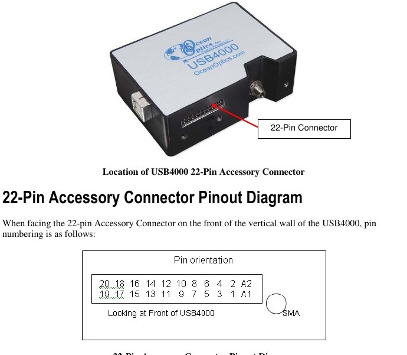
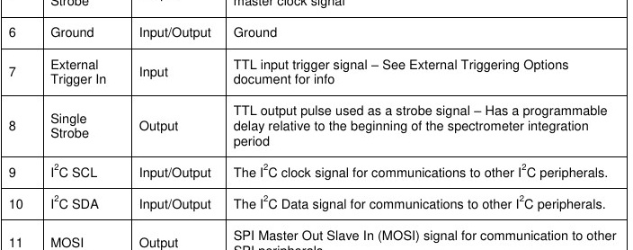

# Ocean Optics USB4000 — I²C Recovery Diagnostics

The verified read-only tools and **original Ocean Optics manual pinout illustrations** for [Unbricking an Ocean Optics USB4000 with ESP32](https://www.hackster.io/eladorbach/unbricking-an-ocean-optics-usb4000-with-esp32-2778e6).

My instrument stopped enumerating over USB (Windows Code 43; Linux USB timeout -110). An ESP-WROVER-KIT accessed the external 22-pin connector and read both EEPROMs. After an instrument-specific, verified FX2 EEPROM repair, the USB4000 enumerated again. A **separate** official FPGA programming step was required before optical acquisition worked.

## Files

| File | Description |
|---|---|
| [images/01_usb4000_manual_22pin_connector_orientation.jpg](images/01_usb4000_manual_22pin_connector_orientation.jpg) | OEM manual photograph and **front-facing** 22-pin connector orientation |
| [images/02_usb4000_manual_i2c_pins_6_9_10.jpg](images/02_usb4000_manual_i2c_pins_6_9_10.jpg) | OEM manual pin definitions for **6 = GND, 9 = SCL, 10 = SDA** |
| [USB4000_I2C_READONLY.ino](USB4000_I2C_READONLY.ino) | ESP32 Arduino read-only I²C scan and EEPROM dump commands |
| [usb4000_offline_diff.py](usb4000_offline_diff.py) | Compare two matching 32 KiB EEPROM backups with an official firmware reference; no device access |
| [usb4000_capture_readonly.py](usb4000_capture_readonly.py) | Host script for capturing and verifying both EEPROMs twice, using the read-only Arduino sketch |

## Wiring

| USB4000 external accessory connector | ESP-WROVER-KIT |
|---|---|
| Pin 6 — Ground | GND |
| Pin 9 — I²C SCL | GPIO22 |
| Pin 10 — I²C SDA | GPIO21 |





**Verify connector orientation and measure I²C levels before wiring.** The ESP32 GPIOs are not 5 V tolerant. Power the spectrometer and the ESP32 independently; connect only GND/SCL/SDA, not the boards' supply pins. The instrument's USB cable must be connected during acquisition.

**Image provenance:** Crops from *Ocean Optics, USB4000 Operating Instructions*, printed pp. 21–22 ([original PDF](https://www.oceanoptics.com/wp-content/uploads/2024/12/USB4000-Operating-Instructions.pdf)). These images illustrate the same two pinouts shown in the Hackster project; Ocean Optics retains the manual's artwork rights.

## Read-only acquisition

Install ESP32 support for Arduino IDE and upload `USB4000_I2C_READONLY.ino`. Open a serial monitor at **115200 baud** and use `SCAN`, `DUMP51`, or `DUMP53`. The example contains **no EEPROM write instructions**.

For verified binary backups, install `pyserial` and run:

```bash
python3 -m pip install pyserial
python3 usb4000_capture_readonly.py --port /dev/serial/by-id/YOUR-ESP32-PORT --output ./private-backups
```

Capture **both 32,768-byte EEPROMs twice**, verify matching copies, and keep the backups private. The host tool expects the `BEGIN` / `DATA` / `END` protocol from the sketch in this repository; it is **not** compatible with the original write-capable recovery firmware's different serial protocol.

For offline analysis with a *confirmed compatible* manufacturer FX2 image:

```bash
python3 usb4000_offline_diff.py private-backups/usb4000_0x51_read1.bin private-backups/usb4000_0x51_read2.bin manufacturer-image.iic
```

## Verified recovery vs. general-purpose code

The actual repair of my unit required an instrument-specific, guarded 60-block FX2 write sequence affecting **932 bytes** while preserving calibration. The USB device subsequently returned as **2457:1022**. The independent OEM Windows FPGA update restored useful spectral response, confirmed with frames at 5, 20 and 100 ms. The original FPGA bitstream was not dumped, so its initial failure mechanism remains uncertain.

**This repository intentionally excludes the instrument-specific write-capable patcher**, serial-specific patch plan, EEPROM backups, calibration data and proprietary firmware binaries. The examples diagnose and back up a USB4000; they do **not** automatically unbrick one. Do not overwrite an EEPROM from this repository.

## OEM resources

- [USB4000 Operating Instructions](https://www.oceanoptics.com/wp-content/uploads/2024/12/USB4000-Operating-Instructions.pdf)
- [Official USB4000 FX2 reference image](https://www.oceanoptics.com/wp-content/uploads/2025/08/usb4000v30200.iic)
- [Official FPGA 3.0.45 image](https://www.oceanoptics.com/wp-content/uploads/2025/08/usb4kv3045.xsvf)
- [Engineering blog](https://eladorbach.com/)
